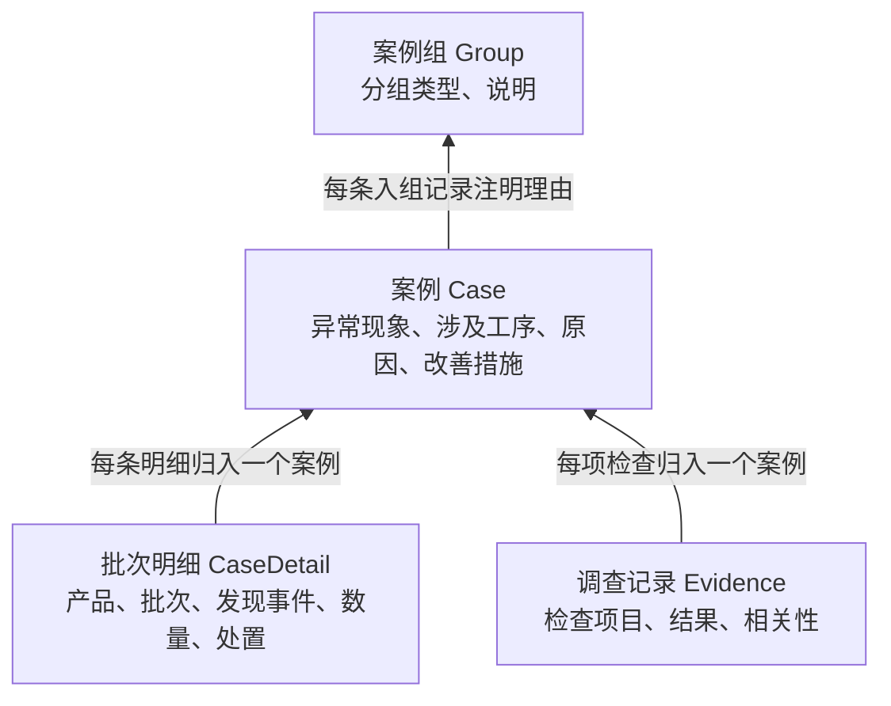

# 模拟案例的建模依据

项目以**封装失效模式**和**产品的实际配置关系**为基础，把一次质量异常调查建成一条案例。演示库的 9 条案例均为合成示例。参考表提供可选的工程知识，每条案例的批次、数量和检查结果则按案例情境设定。

## 模拟案例依据什么生成

| 建模依据 | 提供什么 | 怎样用于模拟案例 |
|---|---|---|
| 产品与工艺资料 | 产品所属客户、产品族、封装路线、固定材料清单 | 先选产品，再沿用其客户、路线和用料。例如，焊线类异常要与产品的封装路线相符。 |
| 封装失效模式参考表 | 异常类型、适用工艺、常见检查方法、可能原因及改善措施 | 选定异常后，从已有条目中选取与本案证据相符的原因和措施。 |
| 案例生成规则 | 批次、生产与发现时间、影响数量、检查事实之间的约束 | 为每次发现事件设定批号、日期和数量，为每起调查设定至少一项检查。按规则，模型只负责把已定事实和选定的结论写成文字。 |

依据见[封装异常参考工作簿](../../data/reference/封装异常_failure_modes_db_structured_v5_engineering_audited-2.xlsx)和[案例生成规则](CaseTrace_Case_Generation_Rules_V1.md)。

## 数据库怎样保存一次调查

一条 **Case** 代表一次完整的异常调查。批次明细说明“哪批产品受到影响”，调查记录说明“做了什么检查、发现了什么”。两类记录都通过案例编号归入同一案。

按模拟案例生成规则，每案有 **1～3 条明细、至少 1 项检查**。按分组规则，每组至少包含 **2 个不同案例**，一个案例可以独立存在，也可以加入多个组。

| 层级（数据库表） | 每条记录保存什么 | 演示库中的焊线脱落案例 |
|---|---|---|
| 批次明细（`case_details`） | 一个生产批的一次发现事件。记录明细编号、所属案例、产品、客户批号、生产批号、生产日期、发现阶段与日期、影响数量及处置。异常类型通过 `detail_failure_modes` 关联。 | D001 属于 C001。产品 PROD_001，客户批 DEV_CL_001，生产批 DEV_PL_001。6 月 1 日生产，6 月 3 日出货检查发现异常，涉及 100 件，隔离并报废。 |
| 调查记录（`evidence_checkpoints`） | 一项检查。记录检查编号、所属案例、检查类型、具体名称（如适用）、结果，以及与异常的关系（相关、无关或待定）。 | E001 属于 C001。拉力试验显示剥离面位于芯片焊盘，复查发现表面污染，清洁对照样品的接合表现恢复。 |
| 案例（`cases`） | 一起调查的案例编号、整案异常描述、补充调查、结案原因及改善措施。确认涉及的工序通过 `case_abnormal_processes` 关联。 | C001 记录焊线脱落，涉及焊线键合工序。结案措施是加强焊盘与载体键合区的来料和清洁管控。 |
| 案例组（`case_groups`） | 组编号、分组类型、说明及可选的其他类型说明。每个成员在 `case_group_memberships` 中单独记录组编号、案例编号和入组理由。 | G001 收录 C001、C003、C004。三案都涉及焊线键合工序，可对照焊点剥离与焊线颈部断裂。 |

可核对[演示案例原文](../../data/dev/demo-v3.json)与[数据库表定义](../../src/casetrace/storage/sql/schema.sql)。
